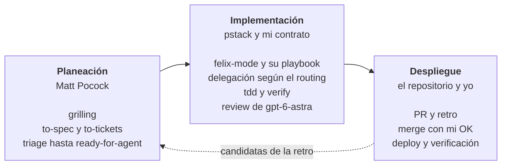

# Felix Agent Engineering

Este repositorio describe cómo trabajo con agentes de código y guarda la
configuración que lo aplica en Claude Code y en Codex.

Configuración documental para que Codex y Claude Code compartan contrato de
orquestación, selección de trabajadores y cierre de encargos, aunque cada
harness use un transporte distinto.

## Filosofía de trabajo

Mi forma de trabajar mezcla dos fuentes con lo que añado yo. Las skills de
[Matt Pocock](https://github.com/mattpocock/skills) cubren la planeación.
[pstack](https://github.com/cursor/plugins/tree/main/pstack), de Lauren Tan
(poteto), cubre la ejecución. Lo mío es cómo delego, reviso y autorizo, igual
en los dos runtimes.

### Una tarea pasa por tres fases



Las partes y las skills de cada fase están en el
[recorrido de una tarea](docs/flujo-de-trabajo.md#recorrido-de-una-tarea).

- **Planeación.** Partes 1 y 2 del recorrido. El agente me entrevista con
  `grilling` hasta que entendemos lo mismo. Después, `to-spec`, `to-tickets` y
  `triage` dejan issues `ready-for-agent`, que el agente toma como brief. Un
  trabajo que no cabe en una sesión pasa antes por `wayfinder`.
- **Implementación.** Partes 3 a 10. `felix-mode` elige el playbook de pstack
  y delega el código según el routing. La fase termina cuando `verify` prueba
  el cambio en la app real y un revisor gpt-6-astra en `high` lo aprueba.
- **Despliegue.** Partes 11 a 13, más lo que pide el `AGENTS.md` de cada
  repositorio. El agente abre el PR y un trabajador corre `retro` sobre la
  sesión. El merge y el deploy esperan mi OK cuando tocan producción. Después
  del deploy, el agente verifica el cambio en producción. Las candidatas de la
  retro vuelven a Planeación como issues `needs-triage`.

### De dónde viene cada idea

| [De Matt Pocock](https://github.com/mattpocock/skills) | [De poteto (pstack)](https://github.com/cursor/plugins/tree/main/pstack) | Mío |
|---|---|---|
| **Grilling.** El agente me entrevista en rondas hasta que entendemos lo mismo. Yo decido y él busca los hechos. | **Probar en lo real.** Nada está hecho hasta que la skill `verify` del proyecto lo prueba en la app. Que compile no basta. | **[Contrato de delegación](docs/orchestration.md).** Despachar → Recoger → Vetar → Cerrar, igual en Claude Code y en Codex. |
| **Tickets en rebanadas.** Cada ticket cruza todas las capas, se puede probar por sí solo y cabe en una sesión. | **Restar antes de sumar.** El cambio más pequeño que resuelve el problema. Primero se quita y después se añade. | **[Modelo por rol y costo](docs/agent-routing.md).** Cada encargo empieza en el modelo más barato que puede hacerlo, con esfuerzo hasta `high`. |
| **Retro.** Cada sesión deja mejoras al entorno del agente, no sólo al código. | **Evidencia etiquetada.** Cada afirmación dice si está medida, inferida o supuesta. | **Review de otro proveedor.** gpt-6-astra revisa con contexto nuevo lo que escribió Claude o gpt-6.1-sol. En alto riesgo se suma Opus. |
| | **Lección en estructura.** Una instrucción que se repite se vuelve lint, script o check. | **[Pausas explícitas](docs/flujo-de-trabajo.md#pausas).** El agente recomienda y espera mi OK antes de un push a `main`, un deploy o una escritura en el sistema de un cliente. |

## Agentic engineering

Estos cinco principios deciden cómo trabajo con agentes. Cada uno dice por qué
y qué parte de este repositorio lo aplica.

1. **El humano decide.** El agente busca los hechos, recomienda y espera. Las
   decisiones de producto y todo lo irreversible son mías, porque yo tengo el
   contexto del negocio y respondo por el resultado. Lo aplican `grilling`, las
   [pausas](docs/flujo-de-trabajo.md#pausas) de `felix-mode` y la autorización
   vigente del contrato.
2. **Delegar no es soltar.** Quien orquesta responde por el resultado aunque
   no haya escrito el código. Lee el diff completo, contrasta cada criterio con
   la evidencia y sólo integra lo que acepta, porque un recibo de lanzamiento
   no prueba que el trabajo se hizo. Cuando orquesta a otros orquestadores,
   cada padre veta su propio subárbol. Lo aplica el
   [contrato](docs/orchestration.md).
3. **Planear antes de codificar.** Un agente empieza con un brief: un issue
   `ready-for-agent`, una spec o un PRD con su condición de terminado. Sin esa
   condición, el agente no sabe cuándo parar ni qué prueba mostrar. Si falta,
   la deriva y la declara antes de empezar. Lo aplican las skills de
   [`vendor/mattpocock/`](vendor/mattpocock/) y la sección «Entrada desde la
   planificación» de [`felix-mode`](skills/felix-mode/SKILL.md).
4. **Cada modelo a su rol y a su costo.** Cada encargo empieza en el modelo
   más barato que puede hacerlo y sube sólo cuando la evidencia muestra que no
   basta. El esfuerzo tiene tope `high`. Así el presupuesto rinde más, y los
   modelos caros quedan para la review y el diseño. Lo aplica el
   [routing](docs/agent-routing.md), con su tabla de modelos y la sección
   «Roles de pstack».
5. **La lección queda escrita.** Un error que se repite no se corrige con otra
   advertencia en el chat. Se vuelve un issue, una línea en el `AGENTS.md` del
   repositorio o, mejor aún, un script o un check. La siguiente sesión no
   recuerda esta conversación. Sólo lee el repositorio. Lo aplican `retro`,
   `pstack:reflect` y `pstack:correct`, y `pao` lleva cada cambio de este
   repositorio a todas mis máquinas.

## Estructura

| Ruta | Propósito |
|------|-----------|
| [`docs/orchestration.md`](docs/orchestration.md) | Fuente canónica del contrato común: roles, descendientes y cierre. |
| [`docs/agent-routing.md`](docs/agent-routing.md) | Tabla de modelos, esfuerzo, escalado, review y UI/UX. |
| [`docs/flujo-de-trabajo.md`](docs/flujo-de-trabajo.md) | Fuente de verdad del flujo: capas, recorrido de una tarea, revisión, pausas y skills. |
| [`docs/native-subagents.md`](docs/native-subagents.md) | Contexto, configuración y seguimiento de subagentes nativos en Codex y Claude Code. |
| [`docs/opencode-workers.md`](docs/opencode-workers.md) | Despacho programático de cheap coders Go: CLI/HTTP, modelo, controles y cierre. |
| [`configs/codex/`](configs/codex/AGENTS.md) | Entry point global de Codex, con el contrato inlineado, y guía Codex → Claude. |
| [`configs/claude/`](configs/claude/CLAUDE.md) | Entry point global de Claude Code, con el contrato inlineado, y guía Claude Code → GPT. |
| [`configs/opencode/`](configs/opencode/opencode.json) | Perfiles DeepSeek V4.1 Flash, MiniMax M3 y Kimi K3, con instrucciones compartidas. |
| [`skills/felix-mode/`](skills/felix-mode/SKILL.md) | Router de ingeniería sobre pstack: precedencia, modelos por rol, revisión y autonomía. |
| [`configs/*/pstack-models.md`](configs/claude/pstack-models.md) | Hojas de modelos de pstack para Claude Code y Codex, derivadas del routing. |
| [`manifest`](manifest) | Registro único de archivos, skills, retiradas y plugins. |
| [`bin/pao`](bin/pao) | Instalador, actualizador y diagnóstico para macOS, Linux y Git Bash. |
| [`vendor/`](vendor/mattpocock/UPSTREAM) | Skills de Matt Pocock, licencia y versión de origen. |
| [`handbook/index.html`](handbook/index.html) | Handbook de consulta rápida del flujo: qué hace el usuario, playbooks, revisión, skills y modelos. |

## Contrato común

El [contrato](docs/orchestration.md) distingue al **orquestador**, responsable
del resultado final, del **trabajador**, que resuelve el encargo, y del
**adaptador**, que transporta una ruta prescrita. Cada delegación pasa por
**Despachar → Recoger → Vetar → Cerrar**.

Los entrypoints globales llevan ese contrato inlineado, de modo que rige desde
el primer turno sin una lectura previa. `docs/orchestration.md` es la fuente
canónica: al editarlo, replica el cambio en ambos entrypoints.

El [routing](docs/agent-routing.md) es la única fuente para elegir modelo,
esfuerzo y pases de review. Los entrypoints apuntan a esa política y copian
su tabla de modelos, que debe mantenerse sincronizada; las guías
describen cómo ejecutarla en cada entorno.

## Rutas de ejecución

| Ruta | Mecanismo | Guía |
|------|-----------|------|
| Codex → GPT | Subagentes nativos de Codex. | [`native-subagents.md`](docs/native-subagents.md), rama Codex |
| Claude Code → Claude | Subagentes nativos de Claude Code. | [`native-subagents.md`](docs/native-subagents.md), rama Claude Code |
| Codex → Claude | Proceso externo `claude -p`, seguido hasta su terminación. | [`claude-workers.md`](configs/codex/docs/claude-workers.md) |
| Claude Code → GPT | Runtime del plugin openai/codex-plugin-cc, adaptador opcional o CLI de Codex. | [`codex-delegation.md`](configs/claude/docs/codex-delegation.md) |
| Codex o Claude Code → OpenCode Go | `opencode run` con perfil/modelo explícitos; servidor HTTP para despacho asíncrono. | [`opencode-workers.md`](docs/opencode-workers.md) |

Un trabajador externo por CLI tiene un ciclo de vida distinto del subagente
nativo. Cada guía explica qué contexto y controles ofrece.

El MCP antiguo `cheap-coder` (`stealth/ox-alpha`) sigue **deprecado**. Los
perfiles Go usan OpenCode y no reactivan ese MCP. Para retirar el antiguo:

```bash
claude mcp remove cheap-coder -s user
# y elimina el bloque [mcp_servers.cheap-coder] de ~/.codex/config.toml
```

## Flujo de ingeniería con pstack

[pstack](https://github.com/cursor/plugins/tree/main/pstack) aporta los
playbooks de ejecución (investigación, bug fix, feature, refactor, prototipo,
PR), sus principios y la verificación sobre el artefacto real. Se instala el
port [pstack-claude](https://github.com/michael-denyer/pstack-claude) para
Claude Code y Codex con su hook apagado, y
[`felix-mode`](skills/felix-mode/SKILL.md) lo adapta:

- La sección «Flujo de ingeniería» de los entrypoints globales invoca
  `felix-mode` en toda tarea no trivial.
- `felix-mode` corre `poteto-mode` con la precedencia usuario > `AGENTS.md`
  del repositorio > contrato y routing > `felix-mode` > pstack.
- Los modelos por rol salen de la sección «Roles de pstack» del
  [routing](docs/agent-routing.md#roles-de-pstack). Cada hoja
  `pstack-models.md` copia sólo lo que su runtime acepta.
- La planificación sigue en las skills de Matt Pocock. Superpowers y las
  skills de Matt Pocock que pstack duplica se retiran.

## Alcance

Este repositorio define el contrato de orquestación, el routing y el flujo de
ingeniería comunes a los proyectos. Cada repositorio declara en su propio
`AGENTS.md`, `CLAUDE.md` o docs locales sus gates, su tracker, su skill
`verify` y, si los necesita, project playbooks en `.agents/playbooks/`.

## Instalación con pao

Requiere Bash 3.2 o posterior, Git y las utilidades del sistema. En Windows,
usa Git Bash con permiso para crear symlinks NTFS, por ejemplo con el modo de
desarrollador activo. Si no puede crear un enlace nativo, la instalación falla.

Revisa el código del port de pstack antes de instalarlo: sus hooks ejecutan
scripts al abrir cada sesión.

```bash
git clone https://github.com/Cosmonaut-itc/felix-agent-engineering.git \
  ~/.local/share/personal-agent-orchestration
cd ~/.local/share/personal-agent-orchestration
bin/pao install
```

La carpeta conserva el nombre anterior del repositorio, que es el que usan las
instalaciones existentes. `pao` funciona desde cualquier ruta. El clon debe
estar en `main`. `manifest` declara todo lo que se instala.
`pao` retira las skills duplicadas y crea enlaces absolutos desde los dos
runtimes al clon. Respalda los archivos y directorios reales antes de
reemplazarlos, aunque su contenido sea idéntico. Informa la ruta de cada
respaldo. Una segunda instalación conserva los enlaces que ya están bien.
No instala `configs/opencode/` ni `outputs/`.

El estado vive en `${XDG_STATE_HOME:-$HOME/.local/state}/pao/`. Allí están
`env`, `status`, las últimas 2000 líneas de `update.log` y `backups/`.
Las skills retiradas que eran directorios reales pasan a
`~/.agents/skills-retired/`.

El job corre cada cuatro horas y al cargar el LaunchAgent en macOS. Usa
LaunchAgent en macOS, cron en Linux y el Programador de tareas en Windows.
Hace `git fetch` y sólo avanza `main` con un fast-forward de `origin/main`.
Un conflicto local o una rama divergente queda registrado como error.
Después sincroniza enlaces y plugins. Si encuentra un archivo real durante
la actualización, lo conserva y lo marca `held`. En macOS notifica los
errores y los archivos `held`. Sin red, el job sólo avisa si hubo un
`fetch` correcto en las últimas 24 horas. Si no lo hubo, o si nunca lo hubo,
lo marca como error.

```bash
# Desde el clon, o con su ruta absoluta.
bin/pao status
bin/pao sync
bin/pao uninstall
```

`status` muestra el último resultado, la rama, los cambios locales, la
distancia respecto a `origin/main` y si el job está instalado. `uninstall`
quita el job y los enlaces al clon. Conserva los respaldos y las skills
retiradas. No desinstala plugins. Si no puede borrar un enlace, lo lista como
pendiente y termina con error. Repetir `uninstall` completa lo que faltó.

Para instalar sin job usa `bin/pao install --no-schedule`. Para omitir los
plugins añade `--no-plugins`. Esa preferencia se guarda para las siguientes
sincronizaciones. Una instalación posterior sin esa opción vuelve a activar
su gestión.

### Actualizaciones de skills y plugins

Las 20 skills de Matt Pocock se distribuyen en `vendor/mattpocock/`, con su
licencia MIT y el tag y commit de origen en `UPSTREAM`. No se editan a mano.
El workflow diario ejecuta `bin/pao vendor-sync`, valida el resultado y
corre las pruebas antes de hacer un commit a `main`. También se puede lanzar
con `workflow_dispatch`. El job local recoge ese commit en la siguiente
actualización.

pstack se instala y actualiza con el CLI de cada runtime si está disponible.
Si falta un CLI, queda `skipped`. Codex siempre gestiona el plugin de la app
con `CODEX_HOME="$HOME/.codex"`. No usa la configuración de la CLI del proxy.
Reinicia las sesiones abiertas después de actualizar pstack. La skill
`verify` de proyecto requiere Claude Code 2.1.200 o posterior.

### Pasos manuales

Confía en el hook de pstack desde `/hooks` en Codex. Con `session hook: off`
en la hoja de modelos, el hook no inyecta contenido aunque lo confíes.

Desinstala el plugin anterior de Matt Pocock para evitar nombres duplicados.
`pao` avisa si lo encuentra habilitado en `~/.claude/settings.json` e imprime
el comando `claude plugin uninstall mattpocock-skills@<marketplace>` con su
identificador. Quita también sus reglas `Skill(skill:mattpocock-skills:...)`
de `permissions.deny`. `pao` no cambia ese JSON.

Si aún tienes Superpowers en Codex, pon `enabled = false` en
`[plugins."superpowers@openai-curated"]` de `~/.codex/config.toml`.
Las skills exigidas por el `AGENTS.md` de cada proyecto se revisan allí.

### Perfiles OpenCode Go

Los perfiles requieren OpenCode y el proveedor Go conectado. Conserva el
archivo de configuración existente: combina la clave `agent` y las variantes
de `provider.opencode-go.models.kimi-k3` de
[`configs/opencode/opencode.json`](configs/opencode/opencode.json) con la
configuración global o del proyecto, y copia `worker-prompt.md` junto al JSON
para resolver su referencia relativa. Revisa colisiones de nombres antes de
combinar. No reemplaces proveedores, MCP ni otras preferencias existentes.

Los perfiles parten de lectura y búsqueda; los permisos de implementación
se fijan por encargo mediante overrides de ejecución. Kimi K3 está habilitado
con low de inicio y high al escalar. Go recibió y aceptó ambos valores en
pruebas reales; el dueño autorizó su uso aceptando que el nivel interno
aplicado no tiene confirmación observable. Sigue la
[guía de transporte](docs/opencode-workers.md) para consultar la evidencia,
las comprobaciones pendientes y los controles de cada despacho.

## Créditos

- [pstack](https://github.com/cursor/plugins/tree/main/pstack) es obra de
  Lauren Tan (poteto). Se instala como plugin por el port
  [pstack-claude](https://github.com/michael-denyer/pstack-claude) de Michael
  Denyer, con licencia MIT. Este repositorio no copia su código.
- Las [skills de Matt Pocock](https://github.com/mattpocock/skills) son
  © 2026 Matt Pocock, con licencia MIT. `vendor/mattpocock/` las copia sin
  modificar junto con su [`LICENSE`](vendor/mattpocock/LICENSE). Ver
  [`vendor/README.md`](vendor/README.md).
