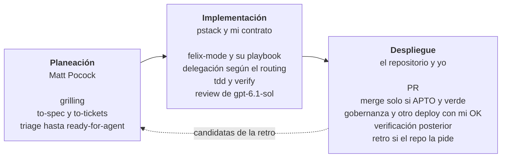

# Felix Agent Engineering

Este repositorio describe cómo trabajo con agentes de código y guarda la
configuración que lo aplica en Claude Code y en Codex.

Configuración documental para que Codex y Claude Code compartan contrato de
orquestación, selección de trabajadores y cierre de encargos, aunque cada
harness use un transporte distinto.

## Filosofía de trabajo

Mi forma de trabajar mezcla dos fuentes con lo que añado yo. Las skills de
[Matt Pocock](https://github.com/mattpocock/skills) cubren la planeación.
[pstack](https://github.com/cursor/plugins/tree/main/pstack), de Lauren Tan
(poteto), cubre la ejecución. Lo mío es cómo delego, reviso y autorizo, igual
en los dos runtimes.

### Una tarea pasa por tres fases



Las partes y las skills de cada fase están en el
[recorrido de una tarea](docs/flujo-de-trabajo.md#recorrido-de-una-tarea).

- **Planeación.** Partes 1 y 2 del recorrido, que uso cuando el trabajo lo
  pide. El agente me entrevista con `grilling` hasta que entendemos lo mismo.
  Con eso, `to-spec` escribe una spec o `to-tickets` la parte en tickets, y
  ambos los publican como `ready-for-agent`. `triage` lleva hasta ese estado
  los issues que llegan sueltos. El agente toma el issue `ready-for-agent` como
  brief. Un trabajo grande cuyo camino aún no está claro pasa antes por
  `wayfinder`.
- **Implementación.** Partes 3 a 10. `felix-mode` elige el playbook de pstack
  y delega el código según el routing. La fase termina cuando el cambio pasa
  la prueba sobre el artefacto real, con `verify` o con los docs de
  verificación del repositorio, y un revisor gpt-6.1-sol en `high` lo aprueba.
  Los tickets que necesitan salir juntos usan el acumulador de `felix-mode`,
  adaptado de `implement-spec`, con una rama de integración y un PR
  acumulador. Cada ticket pasa prueba y review antes de entrar, y el
  acumulador recibe verificación y review del conjunto.
- **Despliegue.** Partes 11 a 13, más lo que pide el `AGENTS.md` de cada
  repositorio. El agente abre el PR y lo mergea solo cuando todas las
  reviews dan APTO y los checks están verdes, aunque el merge dispare un
  deploy. Si despliega o es de alto riesgo, antes un verificador
  independiente corre el cambio. Un PR que toca CI, dependencias o la
  gobernanza de agentes espera mi OK, igual que ejecutar un comando de
  deploy. Después, el agente verifica el cambio como indica el
  repositorio. Donde el `AGENTS.md` lo pide, un trabajador corre `retro`
  sobre la sesión y sus candidatas vuelven a Planeación como issues
  `needs-triage`.

### De dónde viene cada idea

| [De Matt Pocock](https://github.com/mattpocock/skills) | [De poteto (pstack)](https://github.com/cursor/plugins/tree/main/pstack) | Mío |
|---|---|---|
| **Grilling.** El agente me entrevista en rondas hasta que entendemos lo mismo. Yo decido y él busca los hechos. | **Probar en lo real.** Nada está hecho hasta probarlo sobre el artefacto real, con la skill `verify` del proyecto o, si falta, con sus docs de verificación. Que compile no basta. | **[Contrato de delegación](docs/orchestration.md).** Despachar → Recoger → Vetar → Cerrar, igual en Claude Code y en Codex. |
| **Tickets en rebanadas.** Salvo en un refactor amplio, cada ticket cruza todas las capas, se puede probar por sí solo y cabe en una sesión. | **Restar antes de sumar.** El cambio más pequeño que resuelve el problema. Primero quito lo que sobra y después construyo sobre la base más simple. | **[Modelo por rol y costo](docs/agent-routing.md).** Para ejecutar, parto del modelo más barato que puede hacerlo y escalo si no basta. La review y el diseño usan el modelo que el routing fija por rol. |
| **Retro.** Al cerrar una sesión, la retro propone mejoras al entorno del agente, no sólo al código. | **Evidencia etiquetada.** Cada afirmación dice si está medida, inferida o supuesta. | **Review independiente.** gpt-6.1-sol en `high` revisa con contexto nuevo, sin el razonamiento del autor. En alto riesgo se suma Opus. |
| | **Lección en estructura.** Una instrucción que se repite se vuelve lint, script o check. | **[Pausas explícitas](docs/flujo-de-trabajo.md#pausas).** El merge APTO y verde y los efectos de su automatización están autorizados. Un push directo a `main`, un comando de deploy, un PR de gobernanza, CI o dependencias y las demás pausas siguen esperando mi OK. |

## Agentic engineering

Estos cinco principios deciden cómo trabajo con agentes. Cada uno dice por qué
y qué parte de este repositorio lo aplica.

1. **El humano decide.** El agente busca los hechos, recomienda y espera. Las
   decisiones de producto y todo lo irreversible son mías, porque yo tengo el
   contexto del negocio y respondo por el resultado. Lo aplican `grilling`, las
   [pausas](docs/flujo-de-trabajo.md#pausas) de `felix-mode` y la autorización
   vigente del contrato.
2. **Delegar no es soltar.** Quien orquesta responde por el resultado aunque
   no haya escrito el código. Lee el diff completo, contrasta cada criterio con
   la evidencia y sólo integra lo que acepta, porque un recibo de lanzamiento
   no prueba que el trabajo se hizo. Cuando orquesta a otros orquestadores,
   cada padre veta su propio subárbol. Lo aplica el
   [contrato](docs/orchestration.md).
3. **Planear antes de codificar.** Un agente empieza con un brief: un issue
   `ready-for-agent`, una spec o un PRD con su condición de terminado. Sin esa
   condición, el agente no sabe cuándo parar ni qué prueba mostrar. Si falta,
   la deriva y la declara antes de empezar. Lo aplican las skills de
   [`vendor/mattpocock/`](vendor/mattpocock/) y la sección «Entrada desde la
   planificación» de [`felix-mode`](skills/felix-mode/SKILL.md).
4. **Cada modelo a su rol y a su costo.** Para ejecutar, cada encargo empieza
   en el modelo más barato que puede hacerlo y sube sólo cuando la evidencia
   muestra que no basta. La review y el diseño usan el modelo que el routing
   fija para cada rol. El esfuerzo tiene tope `high`. Así el presupuesto rinde
   más sin abaratar la review. Lo aplica el
   [routing](docs/agent-routing.md), con su tabla de modelos y la sección
   «Roles de pstack».
5. **La lección queda escrita.** Un error que se repite no se corrige con otra
   advertencia en el chat. Se vuelve un issue, una línea en el `AGENTS.md` del
   repositorio o, mejor aún, un script o un check. La siguiente sesión no
   recuerda esta conversación. Sólo lee el repositorio. Lo aplican `retro`,
   `pstack:reflect` y `pstack:correct`, y `pao` lleva cada cambio de este
   repositorio a todas mis máquinas.

## Estructura

El [vigilante Windows](scripts/desktop/README.md) observa carga nativa con PowerShell 5.1, sin instalar tareas ni actuar sobre procesos.

| Ruta | Propósito |
|------|-----------|
| [`docs/orchestration.md`](docs/orchestration.md) | Fuente canónica del contrato común: roles, descendientes y cierre. |
| [`docs/agent-routing.md`](docs/agent-routing.md) | Tabla de modelos, esfuerzo, escalado, review y UI/UX. |
| [`docs/flujo-de-trabajo.md`](docs/flujo-de-trabajo.md) | Fuente de verdad del flujo: capas, recorrido de una tarea, revisión, pausas y skills. |
| [`docs/native-subagents.md`](docs/native-subagents.md) | Contexto, configuración y seguimiento de subagentes nativos en Codex y Claude Code. |
| [`docs/opencode-workers.md`](docs/opencode-workers.md) | Despacho programático de cheap coders Go: CLI/HTTP, modelo, controles y cierre. |
| [`docs/t3-delegation.md`](docs/t3-delegation.md) | Mecanismo común de `delegate_task` de T3 Code, primera opción en las rutas Claude Code → GPT y Codex → Claude. |
| [`configs/codex/`](configs/codex/AGENTS.md) | Entry point global de Codex, con el contrato inlineado, y guía Codex → Claude. |
| [`configs/claude/`](configs/claude/CLAUDE.md) | Entry point global de Claude Code, con el contrato inlineado, y guía Claude Code → GPT. |
| [`configs/claude/hooks/duplicate-session-guard`](configs/claude/hooks/duplicate-session-guard) | Hook `SessionStart` que avisa a la sesión, y por notificación de macOS, si otro proceso de Claude Code lanzado por un SDK corre la misma conversación, como cuando T3 Code se actualiza y deja vivo el proceso anterior. Se registra a mano en `~/.claude/settings.json`. |
| [`skills/felix-mode/scripts/`](skills/felix-mode/scripts) | `pstack-refs` comprueba las citas a pasos de pstack contra su registro `pstack-refs.tsv`. `codex-run` despacha trabajadores GPT. Los hooks `laptop-guard` (`PreToolUse`) y `store-guard` (`PostToolUse`) avisan de trabajo pesado en la MacBook y de stores de programa incompletos. `merge-guard` (`PreToolUse`) niega `gh pr merge` sin `--match-head-commit`, con un flag que no admite, como `--admin` o `--auto`, o cuando no puede analizar el comando, y pide confirmación cuando el PR toca CI, dependencias o gobernanza de agentes, o cuando no puede comprobar sus archivos. Los tres se registran a mano en `~/.claude/settings.json`, como dice «Pasos manuales». |
| [`configs/opencode/`](configs/opencode/opencode.json) | Perfiles DeepSeek V4.1 Flash, MiniMax M3 y Kimi K3, con instrucciones compartidas. |
| [`skills/felix-mode/`](skills/felix-mode/SKILL.md) | Router de ingeniería sobre pstack: precedencia, modelos por rol, revisión y autonomía. |
| [`configs/*/pstack-models.md`](configs/claude/pstack-models.md) | Hojas de modelos de pstack para Claude Code y Codex, derivadas del routing. |
| [`manifest`](manifest) | Registro único de archivos, skills, retiradas y plugins. |
| [`bin/pao`](bin/pao) | Instalador, actualizador y diagnóstico para macOS, Linux y Git Bash. |
| [`vendor/`](vendor/mattpocock/UPSTREAM) | Skills de Matt Pocock, licencia y versión de origen. |
| [`handbook/index.html`](handbook/index.html) | Handbook de consulta rápida del flujo: qué hace el usuario, playbooks, revisión, skills y modelos. |

## Contrato común

El [contrato](docs/orchestration.md) distingue al **orquestador**, responsable
del resultado final, del **trabajador**, que resuelve el encargo, y del
**adaptador**, que transporta una ruta prescrita. Cada delegación pasa por
**Despachar → Recoger → Vetar → Cerrar**.

Los entrypoints globales llevan ese contrato inlineado, de modo que rige desde
el primer turno sin una lectura previa. `docs/orchestration.md` es la fuente
canónica: al editarlo, replica el cambio en ambos entrypoints.

El [routing](docs/agent-routing.md) es la única fuente para elegir modelo,
esfuerzo y pases de review. Los entrypoints apuntan a esa política y copian
su tabla de modelos, que debe mantenerse sincronizada; las guías
describen cómo ejecutarla en cada entorno.

## Rutas de ejecución

| Ruta | Mecanismo | Guía |
|------|-----------|------|
| Codex → GPT | Subagentes nativos de Codex. | [`native-subagents.md`](docs/native-subagents.md), rama Codex |
| Claude Code → Claude | Subagentes nativos de Claude Code. | [`native-subagents.md`](docs/native-subagents.md), rama Claude Code |
| Codex → Claude | `delegate_task` de T3 Code cuando está disponible; si no, proceso externo `claude -p`, seguido hasta su terminación. | [`claude-workers.md`](configs/codex/docs/claude-workers.md) |
| Claude Code → GPT | `delegate_task` de T3 Code cuando está disponible; si no, `codex-run` con la CLI de Codex, el runtime del plugin openai/codex-plugin-cc o su adaptador opcional. | [`codex-delegation.md`](configs/claude/docs/codex-delegation.md) |
| Codex o Claude Code → OpenCode Go | `opencode run` con perfil/modelo explícitos; servidor HTTP para despacho asíncrono. | [`opencode-workers.md`](docs/opencode-workers.md) |

Un trabajador externo por CLI tiene un ciclo de vida distinto del subagente
nativo. Cada guía explica qué contexto y controles ofrece.

## Flujo de ingeniería con pstack

[pstack](https://github.com/cursor/plugins/tree/main/pstack) aporta los
playbooks de ejecución (investigación, bug fix, feature, refactor, prototipo,
PR), sus principios y la verificación sobre el artefacto real. Se instala el
port [pstack-claude](https://github.com/michael-denyer/pstack-claude) para
Claude Code y Codex con su hook apagado, y
[`felix-mode`](skills/felix-mode/SKILL.md) lo adapta:

- La sección «Flujo de ingeniería» de los entrypoints globales invoca
  `felix-mode` en toda tarea no trivial.
- `felix-mode` corre `poteto-mode` con la precedencia usuario > `AGENTS.md`
  del repositorio > contrato y routing > `felix-mode` > pstack.
- Los modelos por rol salen de la sección «Roles de pstack» del
  [routing](docs/agent-routing.md#roles-de-pstack). Cada hoja
  `pstack-models.md` copia sólo lo que su runtime acepta.
- La planificación sigue en las skills de Matt Pocock. Superpowers y las
  skills de Matt Pocock que pstack duplica se retiran.
- Cada sesión marca en Linear los tickets que toma con una etiqueta del
  grupo `sesión`. Cada programa lleva su estado en el store de pstack, con
  `units.tsv` y el trail `decisions.tsv`; el hook `store-guard` avisa si
  falta alguno. Una unidad suelta guarda sus encargos en
  `~/.claude/encargos/<slug>/`.

## Alcance

Este repositorio define el contrato de orquestación, el routing y el flujo de
ingeniería comunes a los proyectos. Cada repositorio declara en su propio
`AGENTS.md`, `CLAUDE.md` o docs locales sus gates, su tracker, su skill
`verify` y, si los necesita, project playbooks en `.agents/playbooks/`.

## Instalación con pao

Requiere Bash 3.2 o posterior, Git y las utilidades del sistema. En Windows,
usa Git Bash con permiso para crear symlinks NTFS, por ejemplo con el modo de
desarrollador activo. Si no puede crear un enlace nativo, la instalación falla.

Revisa el código del port de pstack antes de instalarlo: sus hooks ejecutan
scripts al abrir cada sesión.

```bash
git clone https://github.com/Cosmonaut-itc/felix-agent-engineering.git \
  ~/.local/share/personal-agent-orchestration
cd ~/.local/share/personal-agent-orchestration
bin/pao install
```

La carpeta conserva el nombre anterior del repositorio, que es el que usan las
instalaciones existentes. `bin/pao` localiza el clon desde su propia ruta,
así que otra carpeta también sirve. El clon debe estar en `main`. `manifest` declara todo lo que se instala.
`pao` retira las skills duplicadas y crea enlaces absolutos desde los dos
runtimes al clon. Respalda los archivos y directorios reales antes de
reemplazarlos, aunque su contenido sea idéntico. Informa la ruta de cada
respaldo. Una segunda instalación conserva los enlaces que ya están bien.
No instala `configs/opencode/` ni `outputs/`.

El estado vive en `${XDG_STATE_HOME:-$HOME/.local/state}/pao/`. Allí están
`env`, `status`, las últimas 2000 líneas de `update.log` y `backups/`.
Las skills retiradas que eran directorios reales pasan a
`~/.agents/skills-retired/`.

El job corre cada cuatro horas y al cargar el LaunchAgent en macOS. Usa
LaunchAgent en macOS, cron en Linux y el Programador de tareas en Windows.
Hace `git fetch` y sólo avanza `main` con un fast-forward de `origin/main`.
Un conflicto local o una rama divergente queda registrado como error.
Después sincroniza enlaces y plugins. Si encuentra un archivo real durante
la actualización, lo conserva y lo marca `held`. En macOS notifica los
errores y los archivos `held`. Sin red, el job sólo avisa si hubo un
`fetch` correcto en las últimas 24 horas. Si no lo hubo, o si nunca lo hubo,
lo marca como error.

```bash
# Desde el clon, o con su ruta absoluta.
bin/pao status
bin/pao sync
bin/pao uninstall
```

`status` muestra el último resultado, la rama, los cambios locales, la
distancia respecto a `origin/main` y si el job está instalado. `uninstall`
quita el job y los enlaces al clon. Conserva los respaldos y las skills
retiradas. No desinstala plugins. Si no puede borrar un enlace, lo lista como
pendiente y termina con error. Repetir `uninstall` completa lo que faltó.

Para instalar sin job usa `bin/pao install --no-schedule`. Para omitir los
plugins añade `--no-plugins`. Esa preferencia se guarda para las siguientes
sincronizaciones. Una instalación posterior sin esa opción vuelve a activar
su gestión.

### Actualizaciones de skills y plugins

Las 21 skills de Matt Pocock se distribuyen en `vendor/mattpocock/`, con su
licencia MIT y el tag y commit de origen en `UPSTREAM`. No se editan a mano.
El workflow diario ejecuta `bin/pao vendor-sync`, valida el resultado y
corre las pruebas antes de hacer un commit a `main`. También se puede lanzar
con `workflow_dispatch`. El job local recoge ese commit en la siguiente
actualización.

pstack se instala y actualiza con el CLI de cada runtime si está disponible.
Si falta un CLI, queda `skipped`. Codex siempre gestiona el plugin de la app
con `CODEX_HOME="$HOME/.codex"`. No usa la configuración de la CLI del proxy.
Reinicia las sesiones abiertas después de actualizar pstack. La skill
`verify` de proyecto requiere Claude Code 2.1.200 o posterior.

### Pasos manuales

Confía en el hook de pstack desde `/hooks` en Codex. Con `session hook: off`
en la hoja de modelos, el hook no inyecta contenido aunque lo confíes.

Desinstala el plugin anterior de Matt Pocock para evitar nombres duplicados.
`pao` avisa si lo encuentra habilitado en `~/.claude/settings.json` e imprime
el comando `claude plugin uninstall mattpocock-skills@<marketplace>` con su
identificador. Quita también sus reglas `Skill(skill:mattpocock-skills:...)`
de `permissions.deny`. `pao` no cambia ese JSON.

Registra los hooks de Claude Code en la clave `hooks` de
`~/.claude/settings.json`. T3 Code no ejecuta los hooks del frontmatter de una
skill, así que van en la configuración global. Cada comando sale sin efecto si
`pao` aún no instaló el script:

```json
"SessionStart": [{"hooks": [{"type": "command", "timeout": 15,
  "command": "f=\"$HOME/.claude/hooks/duplicate-session-guard\"; [ ! -f \"$f\" ] || bash \"$f\""}]}],
"PreToolUse": [{"matcher": "Bash", "hooks": [{"type": "command", "timeout": 15,
  "command": "f=\"$HOME/.claude/skills/felix-mode/scripts/laptop-guard\"; [ ! -f \"$f\" ] || bash \"$f\""}]},
  {"matcher": "Bash", "hooks": [{"type": "command", "timeout": 15,
  "command": "f=\"$HOME/.claude/skills/felix-mode/scripts/merge-guard\"; [ ! -f \"$f\" ] || bash \"$f\""}]}],
"PostToolUse": [{"matcher": "Bash|Write|Edit|MultiEdit", "hooks": [{"type": "command", "timeout": 15,
  "command": "f=\"$HOME/.claude/skills/felix-mode/scripts/store-guard\"; [ ! -f \"$f\" ] || bash \"$f\""}]}]
```

Si aún tienes Superpowers en Codex, pon `enabled = false` en
`[plugins."superpowers@openai-curated"]` de `~/.codex/config.toml`.
Las skills exigidas por el `AGENTS.md` de cada proyecto se revisan allí.

### Perfiles OpenCode Go

Los perfiles requieren OpenCode y el proveedor Go conectado. Conserva el
archivo de configuración existente: combina la clave `agent` y las variantes
de `provider.opencode-go.models.kimi-k3` de
[`configs/opencode/opencode.json`](configs/opencode/opencode.json) con la
configuración global o del proyecto, y copia `worker-prompt.md` junto al JSON
para resolver su referencia relativa. Revisa colisiones de nombres antes de
combinar. No reemplaces proveedores, MCP ni otras preferencias existentes.

Los perfiles parten de lectura y búsqueda; los permisos de implementación
se fijan por encargo mediante overrides de ejecución. Kimi K3 está habilitado
con low de inicio y high al escalar. Go recibió y aceptó ambos valores en
pruebas reales; el dueño autorizó su uso aceptando que el nivel interno
aplicado no tiene confirmación observable. Sigue la
[guía de transporte](docs/opencode-workers.md) para consultar la evidencia,
las comprobaciones pendientes y los controles de cada despacho.

## Créditos

- [pstack](https://github.com/cursor/plugins/tree/main/pstack) es obra de
  Lauren Tan (poteto). Se instala como plugin por el port
  [pstack-claude](https://github.com/michael-denyer/pstack-claude) de Michael
  Denyer, con licencia MIT. Este repositorio no copia su código.
- Las [skills de Matt Pocock](https://github.com/mattpocock/skills) son
  © 2026 Matt Pocock, con licencia MIT. `vendor/mattpocock/` las copia sin
  modificar junto con su [`LICENSE`](vendor/mattpocock/LICENSE). Ver
  [`vendor/README.md`](vendor/README.md).
